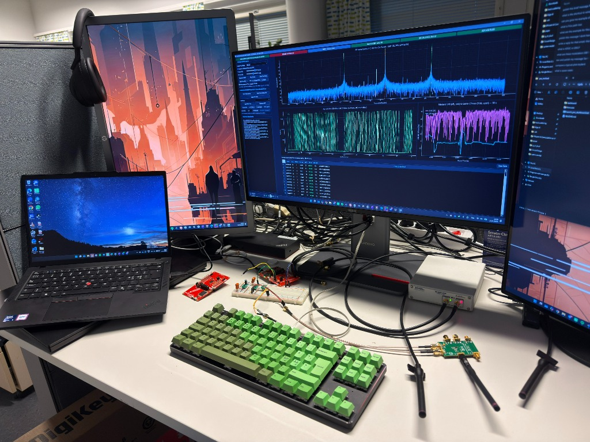
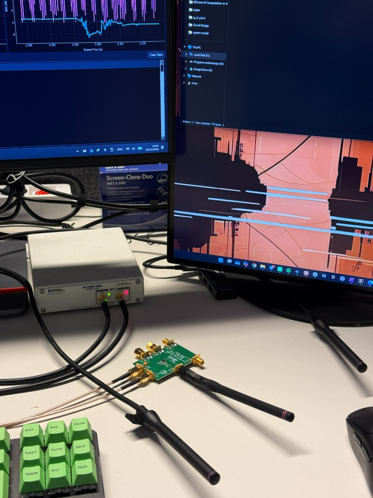
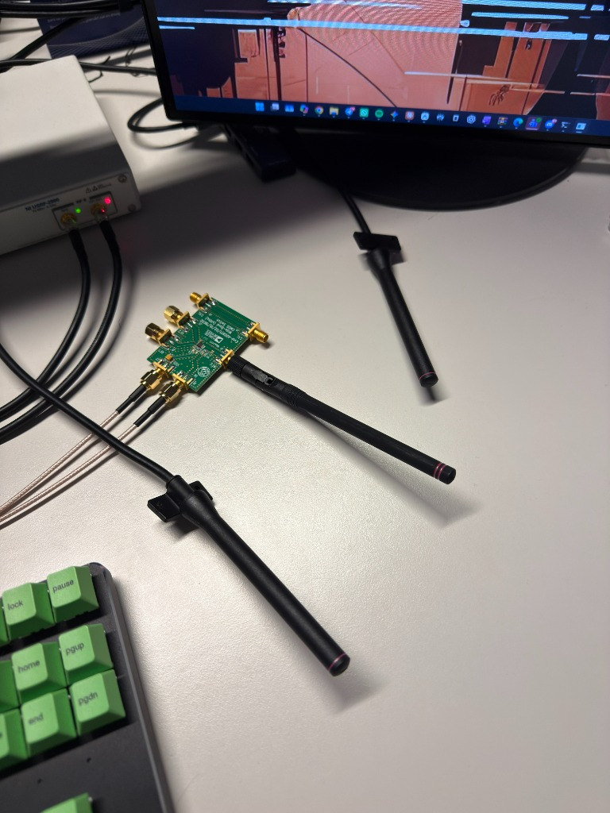

# 2.4 GHz Passive RF Backscatter Tag Firmware & SDR Testbed

Bare-metal (`NoRTOS`) **TI CC2652R1** embedded firmware and **NI USRP-2900** SDR verification testbed for **2.4 GHz passive RF backscatter communication**. Designed and verified end-to-end over the air using an `EVAL-ADG902EBZ` SPST RF switch, `TPS7A0225` 2.5 V LDO, and `SN74LVC1T45` level translator.



---

## Overview

Instead of generating a 2.4 GHz RF carrier on the tag, the **CC2652R1** modulates an external 2.4 GHz CW illumination signal by switching the antenna termination between **Reflect** (`OPEN`, $\Gamma \approx +1$) and **Absorb** (`50 Ω`, $\Gamma \approx 0$) using a `200 kHz` subcarrier.

### Key Firmware & Hardware Features
- **Single-Pin Subcarrier Modulation (`DIO21`):** `GPT0A` runs a continuous `200.000 kHz` (50% duty) hardware PWM while `GPT1A` (`1.000 kHz` ISR) atomically gates `DIO21` via `IOCIOPortIdSet` (`IOC_PORT_MCU_PORT_EVENT0` vs `IOC_PORT_GPIO`) to transmit `1.000 kbps` OOK packets without an external AND gate.
- **Packet Frame (`88 bits` / `88 ms`):**
  `Preamble (0xAA)` + `Sync Word (0xD391)` + `Magic (0xA5)` + `Seq (8b)` + `BTN2 Count (8b)` + `Payload (16b, e.g. "OK", "C0".."C9")` + `CRC-8-CCITT (poly=0x07)` + `Guard Gap (16b)`.
- **Standalone Hardware & UART Control:**
  - `BTN-1 (DIO13)`: Cycles RF switch modes (`LOAD50` → `CW200K` → `OPEN`).
  - `BTN-2 (DIO14)`: Triggers/steps `1.0 kbps` counting backscatter packets (`"C0"`..`"C9"`).
  - `UART2 (115200 8N1)`: Live telemetry (`POC_MCU|...`) and runtime CLI (`MODE:PKT`, `MODE:CW`, `ASCII:XX`, `STATUS?`).
- **Offset-CW SDR Receiver:** Transmits `+20 kHz` offset CW on USRP `TX/RX` to bypass `0 Hz` DC-offset cancellation, placing backscatter sidebands cleanly at `-180 kHz` (LSB) and `+220 kHz` (USB) with `>36–45 dB` sideband SNR.

---

## Hardware Benchtop Photos

| USRP-2900 & ADG902 RF Switch | EVAL-ADG902EBZ & 2.4 GHz Antenna |
| :---: | :---: |
|  |  |

### Pinout & Power Domain (`LAUNCHXL-CC26X2R1` → `EVAL-ADG902EBZ`)
- **`TPS7A0225` LDO:** Steps LaunchPad `3.3 V` down to `2.50 V` for `ADG902 VDD` (`J7`) and level-translator `VCCA`.
- **`SN74LVC1T45` Level Translator:** Translates `DIO21` (`0 / 3.3 V`) to `0 / 2.50 V` (`ADG902 J6 CTRL`), protecting the RF switch `VDD` limit.

---

## Repository Structure

```text
├── firmware/
│   ├── backscatter_tag.c          # CC2652R1 NoRTOS 200 kHz PWM + 1.0 kbps OOK & CRC-8 firmware
│   ├── backscatter_tag.syscfg     # TI SysConfig pinmux & peripheral configuration
│   ├── main_nortos.c              # NoRTOS entry point
│   ├── cc13x2_cc26x2_nortos.cmd   # Linker command file
│   ├── CC2652R1F_XDS110.ccxml     # XDS110 target config for DSLite
│   ├── Makefile                   # TI Arm Clang (tiarmclang) build rules
│   └── build_and_flash.ps1        # Automated build, erase, flash & verify script
├── dashboard/
│   ├── poc_sdr_engine.py          # 1.0 kbps PoC codec, +/-200 kHz DSP, UHD & UART workers
│   └── backscatter_poc_dashboard.py # PyQt5 + pyqtgraph live spectrum & packet decoder UI
├── images/                        # Benchtop hardware & live RF verification photos
└── TECHNICAL_DOCUMENTATION.md     # Detailed architecture & register-level notes
```

---

## Quick Start

### 1. Build & Flash Firmware (`LAUNCHXL-CC26X2R1`)
Requires **TI CCS / Arm Clang (`tiarmclang`)**, **SimpleLink CC13xx/CC26xx SDK 8.33**, and **SysConfig 1.21**.
```powershell
powershell -ExecutionPolicy Bypass -File firmware\build_and_flash.ps1 -Stage Pkt
```

### 2. Run Companion SDR Dashboard (Optional, NI USRP-2900 or Offline Self-Test)
```powershell
python dashboard\backscatter_poc_dashboard.py --self-test
```

---

## Verified Live RF Results (NI USRP-2900)
- **Static Load Toggle (`OPEN` ↔ `LOAD50`):** Repeatable `+9.6°` carrier phase step and `-0.6 dB` amplitude step.
- **200 kHz Subcarrier (`CW200K`):** `-180 kHz` / `+220 kHz` sidebands measured at **+45.58 dB SNR** above noise floor.
- **Over-the-Air Packets (`MODE:PKT`):** **15/15 CRC-OK** (`0` packet loss) with live `BTN-2` payload switching (`"OK"` → `"C1"`).
