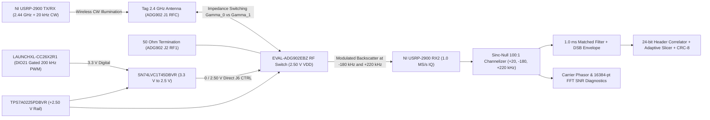

# 2.4 GHz Single-Pin Direct-Subcarrier Backscatter PoC: Complete Technical Reference, DSP Theory, and Evaluation Protocol

**Applies to Codebase Snapshot:** `poc_testbed/` (and backup `poc_testbed_backups/v1.0_working_2026-11-19/`)  
**Hardware Platform:** TI `LAUNCHXL-CC26X2R1` (CC2652R1) + `TPS7A0225PDBVR` (`2.50 V` LDO) + `SN74LVC1T45DBVR` Level Shifter + Analog Devices `EVAL-ADG902EBZ` RF Switch + `NI USRP-2900` (`B200` / AD9361)

---

## 1. Executive Summary & Software Stack (No GNU Radio Used)

### 1.1 Was GNU Radio Used?
**No.** All GNU Radio and legacy `v7` flowgraph components were removed completely. Instead, the working PoC system in `poc_testbed/` was built **from scratch** on a lightweight, transparent, deterministic Python + C stack:

| Layer | Implementation in `poc_testbed/` | Toolchain / Libraries | Why Chosen Over GNU Radio |
| :--- | :--- | :--- | :--- |
| **Tag MCU Firmware** | [backscatter_tag.c](file:///c:/Users/hjafa/OneDrive/Desktop/back%20scattering/poc_testbed/firmware/backscatter_tag.c), [main_nortos.c](file:///c:/Users/hjafa/OneDrive/Desktop/back%20scattering/poc_testbed/firmware/main_nortos.c), [backscatter_tag.syscfg](file:///c:/Users/hjafa/OneDrive/Desktop/back%20scattering/poc_testbed/firmware/backscatter_tag.syscfg) | TI SimpleLink CC13xx/CC26xx SDK `8.33.00.16` (`NoRTOS`), SysConfig `1.21.1`, `tiarmclang 5.1.1.LTS` | Sub-microsecond deterministic hardware PWM + `GPTimer1A` ISR timing; standalone operation on battery/USB power without a PC. |
| **SDR Hardware I/O** | `UsrpWorker` in [poc_sdr_engine.py](file:///c:/Users/hjafa/OneDrive/Desktop/back%20scattering/poc_testbed/dashboard/poc_sdr_engine.py) | Native `uhd.usrp.MultiUSRP("type=b200")` (`UHD 4.8.0.0-release`) | Direct control over TX/RX streamers, bounded `5 ms` bursts, clean `stop_cont` and `end_of_burst` teardown (prevents WinUSB/FX3 lockups seen with unbounded GNU Radio `tb.run()` graphs). |
| **Real-Time DSP & Codec** | `PocPacketCodec` & `compute_spectrum_and_snr` in [poc_sdr_engine.py](file:///c:/Users/hjafa/OneDrive/Desktop/back%20scattering/poc_testbed/dashboard/poc_sdr_engine.py) | Vectorized `NumPy` (`1.0 MS/s`, `50,000`-sample blocks) | Zero opaque black-box GNU Radio blocks; every filter, downconverter, matched filter, correlator, and CRC check is explicit, inspectable mathematics suitable for paper methods sections. |
| **Unified Dashboard & Control** | [backscatter_poc_dashboard.py](file:///c:/Users/hjafa/OneDrive/Desktop/back%20scattering/poc_testbed/dashboard/backscatter_poc_dashboard.py) | `PyQt5`, `pyqtgraph 0.13.7`, Win32 `ctypes` COM serial (`Win32Serial`), `DSLite.exe` CLI | Single integrated UI for firmware build/erase/flash, UART telemetry (`COM3`), real-time spectrum/oscilloscope/phase plots, gain auto-tuning, and decoded packet tables. |

### 1.2 End-to-End System Architecture

---

## 2. Hardware Architecture & RF Physics (Direct Single-Pin Control)

### 2.1 Verified Prototype Netlist (No External AND Gate)
An earlier prototype used two MCU pins (`DIO21` subcarrier + `DIO24` data) combined externally through an `SN74AUP1G08` AND gate. Removing the AND gate and gating the `200 kHz` PWM directly on `DIO21` inside the CC2652R1 cut breadboard wiring in half, eliminated inter-chip switching hazards, and produced clean `+45.6 dB` RF backscatter sidebands.

| Device | Adapter Pin | IC Pin | Net / Destination | Electrical Role |
| :--- | :---: | :---: | :--- | :--- |
| **LDO** `TPS7A0225PDBVR` | `1` | `IN` | `+3.3V` | LaunchPad `3V3` supply rail |
| **LDO** `TPS7A0225PDBVR` | `2` | `GND` | `GND` | Common ground reference |
| **LDO** `TPS7A0225PDBVR` | `3` | `EN` | `+3.3V` | Always enabled |
| **LDO** `TPS7A0225PDBVR` | `6` | `OUT (Pin 5)` | `+2.5V` | Regulated `+2.50 V` supply for `VCCA` and `EVAL-ADG902EBZ J7 VDD` |
| **VLT** `SN74LVC1T45DBVR` | `1` | `VCCA` | `+2.5V` | Output-side supply (`A` side matches `ADG902` `2.75 V` max rating) |
| **VLT** `SN74LVC1T45DBVR` | `2` | `GND` | `GND` | Common ground |
| **VLT** `SN74LVC1T45DBVR` | `3` | `A` | **`EVAL-ADG902EBZ J6` center** | `0 / 2.50 V` direct RF-switch `CTRL` input |
| **VLT** `SN74LVC1T45DBVR` | `4` | `B` | **LaunchPad `DIO21` (`Left outer Pin 8`)** | `0 / 3.30 V` MCU control / software-gated `200 kHz` PWM |
| **VLT** `SN74LVC1T45DBVR` | `5` | `DIR` | `GND` | Locked `B -> A` (`3.3 V -> 2.5 V` unidirectional) |
| **VLT** `SN74LVC1T45DBVR` | `6` | `VCCB` | `+3.3V` | Input-side supply (`B` side matches CC2652R1 `3.3 V` GPIO) |
| **RF Switch** `EVAL-ADG902EBZ` | `J1`, `J2` | `RFC`, `RF1` | `2.4 GHz ANT` (`J1`), `50 Ohm Load` (`J2`) | Absorptive SPST load modulator (`132360` `50 Ω` termination) |

*Note:* `DIO24` (`BoosterPack Pin 6`) remains configured in firmware as an optional baseband data-envelope monitor output for an oscilloscope probe, decoupled from the RF path.

### 2.2 Backscatter Reflection & Subcarrier Modulation Physics
When an incident CW tone at frequency $f_c + f_{\text{off}}$ illuminates the tag antenna (`J1`), the complex reflection coefficient $\Gamma(t)$ seen at the antenna port alternates between two states driven by `J6 CTRL`:
* **`CTRL = 0.00 V` (OFF / Reflective State, $\Gamma_0$):** The `ADG902` channel is open/high-isolation, reflecting the incident wave back toward `RX2`.
* **`CTRL = +2.50 V` (ON / Absorptive State, $\Gamma_1$):** The `ADG902` connects `J1 (RFC)` to the matched `50 Ω` termination on `J2 (RF1)`, absorbing incident RF energy and shifting both the amplitude and phase of the reflected wave ($\Delta\Gamma = \Gamma_1 - \Gamma_0$).

If the MCU keeps `J6 CTRL` static (`OPEN` vs. `LOAD50`), only the carrier phasor at $f_c + f_{\text{off}}$ shifts by a constant complex delta $\Delta\Gamma$ (static multipath + direct TX-to-RX coupling dominates, making low-SNR detection difficult). To decouple the weak tag reflection from strong static clutter and TX leakage:
1. During an active `1`-bit ($T_b = 1.000\text{ ms}$), `DIO21` toggles `J6 CTRL` with a $50\%$ duty-cycle square wave $m(t) \in \{0, 1\}$ at subcarrier frequency $f_{\text{sub}} = 200.000\text{ kHz}$.
2. Expanding $m(t)$ via Fourier series yields:

$$m(t) = \frac{1}{2} + \frac{2}{\pi}\sum_{k=1,3,5,\dots}^{\infty} \frac{\sin(2\pi k f_{\text{sub}} t)}{k}$$

3. Multiplying the complex baseband carrier $A_{\text{tx}} e^{j 2\pi f_{\text{off}} t}$ by $\Gamma_0 + \Delta\Gamma \cdot b_n m(t)$ (where $b_n \in \{0, 1\}$ is the OOK data bit) creates clean symmetric **double-sideband (DSB) fundamental tones** at:

$$f_{\text{USB}} = f_{\text{off}} + f_{\text{sub}} = +20\text{ kHz} + 200\text{ kHz} = +220.000\text{ kHz}$$

$$f_{\text{LSB}} = f_{\text{off}} - f_{\text{sub}} = +20\text{ kHz} - 200\text{ kHz} = -180.000\text{ kHz}$$

with each sideband carrying complex envelope amplitude proportional to $\frac{1}{\pi} |\Delta\Gamma| b_n$ completely clear of static room reflections and `0 Hz` LO leakage.

---

## 3. CC2652R1 MCU Firmware Design ([backscatter_tag.c](file:///c:/Users/hjafa/OneDrive/Desktop/back%20scattering/poc_testbed/firmware/backscatter_tag.c))

### 3.1 Clocking & Determinism
* **Crystal Lock (`lockHighFreqCrystal`):** Requests `PowerCC26XX_XOSC_HF`, asserts `PowerCC26XX_DISALLOW_STANDBY` and `PowerCC26XX_DISALLOW_IDLE`, enables `PowerCC26XX_PERIPH_GPT1`, and spins until `OSCClockSourceGet(OSC_SRC_CLK_HF) == OSC_XOSC_HF` (`48.000 MHz` crystal stability, eliminating RC oscillator frequency drift).
* **Subcarrier PWM (`GPTimer0A`, `CONFIG_PWM_SUBCARRIER`):** Configured via TI `PWM` driver (`PWM_PERIOD_HZ = 200000U`, `PWM_DUTY_FRACTION = 50%`, `PWM_IDLE_LOW`). Unlike start/stop approaches that disturb timer phase and pin mux timing, **`PWM_start(gPwmHandle)` runs continuously in hardware**, maintaining a free-running `200.000 kHz` square wave (`240` clock ticks per period at `48 MHz`). `GPIO_setOutputEnableDio(CONFIG_GPIO_PWM_0, GPIO_OUTPUT_ENABLE)` latches the output driver enable for direct GPIO mode.
* **Bit-Rate Timer (`GPTimer1A`, `initBitTimer`):** Configured in 32-bit periodic mode (`TIMER_CFG_PERIODIC`) with load count `BIT_TIMER_LOAD_COUNTS = 48000U - 1U`, generating an exact **`1,000.000 Hz` (`1.000 ms`)** hardware interrupt (`INT_GPT1A`, `HwiP` priority `0x20`). The ISR maintains the monotonic millisecond clock `gTickMs` alongside bit shifting.

### 3.2 Glitchless Single-Pin Multiplexing (`driveTagPin`)
Every `1.000 ms` tick (and synchronously inside `applyMode`), the ISR drives `DIO21` (`CONFIG_GPIO_PWM_0`) cleanly via IO Controller register remapping (`driverlib/ioc.h`):
* **`TAG_PIN_PWM200K` (`bit = 1` in `PKT` or `CW200K`):** `IOCIOPortIdSet(21, IOC_PORT_MCU_PORT_EVENT0)` connects `DIO21` directly to the continuously running `GPTimer0A` `200 kHz` PWM output.
* **`TAG_PIN_LOW` (`bit = 0` or `OPEN`):** `GPIO_writeDio(21, 0U)` followed by `IOCIOPortIdSet(21, IOC_PORT_GPIO)` forces `DIO21` to `0.00 V` (`J6 CTRL = 0.00 V`).
* **`TAG_PIN_HIGH` (`LOAD50`):** `GPIO_writeDio(21, 1U)` followed by `IOCIOPortIdSet(21, IOC_PORT_GPIO)` forces `DIO21` to `3.30 V` (`J6 CTRL = +2.50 V`).

Because `GPIO_writeDio` presets the GPIO output latch **before** switching `PORT_ID` back to `IOC_PORT_GPIO`, static transitions have zero voltage glitches, and `PKT` bit transitions preserve coherent `200 kHz` timer phase across packets.

### 3.3 Operating Modes, Standalone Buttons & UART Interface

| Mode (`TagMode_t`) | Trigger | `DIO21` Waveform | `ADG902 J6 CTRL` | LaunchPad LEDs (`Red` / `Green`) | Purpose |
| :--- | :--- | :--- | :--- | :--- | :--- |
| `MODE_0_LOAD_OPEN` (`OPEN`) | `BTN-1` cycle / `MODE:OPEN` | Static `LOW` (`0.00 V`) | `0.00 V DC` | Red **OFF** / Green **OFF** | Open/reflective baseline for static phase test |
| `MODE_1_LOAD_50OHM` (`LOAD50`) | `BTN-1` cycle / `MODE:LOAD50` | Static `HIGH` (`3.30 V`) | `+2.50 V DC` | Red **ON** / Green **OFF** | `50 Ω` absorptive termination check |
| `MODE_2_CW_SUBCARRIER` (`CW200K`) | `BTN-1` cycle / `MODE:CW` | `200.000 kHz` `50%` PWM | `0 / 2.50 V @ 200 kHz` | Red **ON** / Green **ON** | Maximum-SNR unmodulated sideband tuning |
| `MODE_3_PACKETS_1KBPS` (`PKT`) | Power-on default / `BTN-2` / `MODE:PKT` | `1.000 kbps` gated `200 kHz` PWM | Bursts (`72 ms` active + `16 ms` guard) | Green **blinks** (every 4 pkts) / Red **120 ms pulse** on `BTN-2` | Full counting packet transmission |

* **Hardware Buttons (`50 ms` debounce):**
  * **`BTN-1` (`DIO13`, Left, Internal Pull-Up):** Switches RF load state directly (`LOAD50` → `CW200K` → `OPEN` → `LOAD50`). Pressing from `PKT` enters `LOAD50` immediately.
  * **`BTN-2` (`DIO14`, Right, Internal Pull-Up):** Increments `gBtn2Count`, updates the 2-byte ASCII payload dynamically (`'C'` + `'0' + (gBtn2Count % 10)` -> `"C1"`, `"C2"`, ..., `"C9"`, `"C0"`), flashes Red LED for `120 ms`, and (if coming from a non-packet mode) resets `seq = 0`, `tx = 0` and starts `MODE_3_PACKETS_1KBPS`.
* **UART Control (`XDS110 UART2`, `115200 8N1`, Non-Blocking):**
  * Emits periodic `1 Hz` + event-driven telemetry: `POC_MCU|mode=<MODE>|seq=<0..255>|btn1=<N>|btn2=<N>|pay=<HEX4>|tx=<COUNT>\r\n`.
  * Accepts newline-terminated commands: `MODE:OPEN` / `MODE:OFF`, `MODE:LOAD50` / `MODE:LOAD`, `MODE:CW` / `MODE:CW200K`, `MODE:PKT` / `MODE:COUNT`, `BTN1`, `BTN2`, `ASCII:XX`, `PAY:XXXX`, and `STATUS?`.

---

## 4. Packet Protocol, Bitrate, Goodput & CRC-8 Analysis

### 4.1 88-Bit Physical Frame Layout (`11` Bytes, MSB-First)

| Byte Offset | Bit Length | Field | Value / Encoding | Purpose |
| :---: | :---: | :--- | :--- | :--- |
| `0` | `8` | **Preamble** | `0xAA` (`10101010`) | Balanced `1`/`0` transitions for envelope peak detection & adaptive threshold estimation |
| `1..2` | `16` | **Sync Word** | `0xD391` (`11010011 10010001`) | Low autocorrelation sidelobe frame delimiter (`6.3e4` rejection ratio) |
| `3` | `8` | **Protocol Magic** | `0xA5` (`10100101`) | Fixed protocol identifier covered by CRC-8 |
| `4` | `8` | **Sequence Counter (`seq`)** | `0x00..0xFF` | Rolling counter incremented per transmitted packet (`0..255` wrap) for packet-loss / gap tracking |
| `5` | `8` | **Button Counter (`btn2_count`)** | `0x00..0xFF` | Live count of `BTN-2` presses on the LaunchPad |
| `6..7` | `16` | **User Payload (`pay_hi`, `pay_lo`)** | Big-endian 16-bit (`0x4F4B` = `"OK"` default, `"C0".."C9"` via `BTN-2`, arbitrary via UART) | Live mutable sensor/user data |
| `8` | `8` | **CRC-8-CCITT** | `poly = 0x07`, `init = 0x00`, over **5 bytes** `[Byte 3 .. Byte 7]` | Frame integrity verification |
| `9..10` | `16` | **Inter-Frame Guard Gap** | `0x0000` (16 silent `0` bits = `16.0 ms`) | Guarantees dark baseline between bursts and isolates adjacent frames |

### 4.2 Bitrate & Throughput Calculations
At the configured bit period $T_b = 1.000\text{ ms}$ (`BIT_TIMER_LOAD_COUNTS = 48000 - 1` at `48.000 MHz`):
* **Raw Physical Bitrate ($R_{\text{PHY}}$):** $\frac{1}{1.000\text{ ms}} = \mathbf{1.000\text{ kbps}}$
* **Total Frame Cycle Duration:** $88\text{ bits} \times 1.000\text{ ms/bit} = \mathbf{88.0\text{ ms}}$ (`72 ms` active + `16 ms` guard)
* **Packet Transmission Rate:** $\frac{1}{0.088\text{ s}} = \mathbf{11.364\text{ packets/s}}$
* **Protected Protocol Body Goodput (`40` bits / `88 ms`):** $\mathbf{454.5\text{ bps}}$ (`Magic`, `Seq`, `BTN2`, `PayHi`, `PayLo`)
* **Variable Information Goodput (`32` bits / `88 ms`):** $\mathbf{363.6\text{ bps}}$ (`Seq`, `BTN2`, `Payload`)
* **Pure 16-Bit User Payload Goodput (`16` bits / `88 ms`):** $\mathbf{181.8\text{ bps}}$

### 4.3 False-Positive Rejection Math
A spurious random-noise alignment must simultaneously pass:
1. Header normalized bipolar correlation $\ge 0.16$ and contrast $\bar{E}_1 > 1.25\,\bar{E}_0$ across the 24 header bits;
2. Exact 16-bit Sync Word match (`0xD391`, probability $2^{-16}$);
3. Exact 8-bit Magic match (`0xA5`, probability $2^{-8}$);
4. Exact 8-bit CRC-8 match (probability $2^{-8}$).

Joint random-bit false-acceptance probability per alignment is bounded below $2^{-(16+8+8)} = 2^{-32} \approx 2.33 \times 10^{-10}$, ensuring spurious noise packets virtually never appear in the decoded packet log.

---

## 5. NI USRP-2900 Transceiver & DSP Pipeline ([poc_sdr_engine.py](file:///c:/Users/hjafa/OneDrive/Desktop/back%20scattering/poc_testbed/dashboard/poc_sdr_engine.py))

### 5.1 `+20.000 kHz` Offset-CW Full-Duplex Configuration
* **Center Frequency:** `2.440 GHz` (`CENTER_FREQ_HZ = 2_440_000_000.0`).
* **Baseband Sample Rate:** `1.000 MS/s` (`SAMPLE_RATE_HZ = 1_000_000.0`, `fc32` host / `sc16` wire format), AGC disabled (`set_rx_agc(False, 0)`), bistatic ports `TX/RX` (CW output) and `RX2` (backscatter input).
* **Why `+20.000 kHz` TX Offset Instead of `0 Hz` DC?**
  Direct-conversion SDR front-ends (AD9361 inside USRP-2900 / B200) apply continuous baseband DC-offset tracking/cancellation around `0 Hz`, which severely attenuates stationary `0 Hz` carrier phase measurements and adds residual LO feedthrough near `0 Hz`. Transmitting complex tone $0.707\,e^{+j 2\pi (20\text{ kHz}) t}$ moves the unmodulated carrier completely outside the `0 Hz` DC notch (leaving carrier magnitude $|c|$ and phase $\angle c$ undistorted) while shifting tag sidebands cleanly to **`-180.000 kHz` (LSB)** and **`+220.000 kHz` (USB)**.
* **USB Transfer Geometry:** Every transfer is `chunk_samples = 5000` (`5.0 ms`), accumulated in `10`-chunk frames (`N = 50,000` samples = `50.0 ms`, `20 Hz` dashboard update rate). Because $5000 \times \frac{20\text{ kHz}}{1\text{ MHz}} = 100.0$ exact cycles, the `5000`-sample TX tone repeats continuously across USB boundaries with **zero phase discontinuity**, and carrier phase across consecutive `50 ms` RX frames stays coherent as long as TX/RX remain continuously streaming.

### 5.2 Exact Integer-Cycle `100:1` Sinc-Null Channelizer (`1.0 MS/s -> 10.0 kS/s`)
Each `50,000`-sample IQ frame is reshaped into `500` non-overlapping blocks of length $D = 100$ (`0.1 ms` per output sample, $F_{\text{env}} = 10.0\text{ kS/s}$). Over $D = 100$ samples at $F_s = 1.0\text{ MS/s}$:
* `+20.0 kHz` carrier completes **$2$ exact cycles** ($2\pi \cdot 2$).
* `+220.0 kHz` USB completes **$22$ exact cycles** ($2\pi \cdot 22$).
* `-180.0 kHz` LSB completes **$-18$ exact cycles** ($-2\pi \cdot 18$).

Evaluating the decimated complex sample $z[m]$ for channel offset $f_k \in \{+20\text{ kHz}, +220\text{ kHz}, -180\text{ kHz}\}$:

$$z_k[m] = \frac{1}{100}\sum_{r=0}^{99} x[100m + r] \, e^{-j 2\pi \frac{f_k}{F_s} r}$$

has the mathematical property of a $100$-tap boxcar (sinc frequency response with exact zeros at every multiple of $10.0\text{ kHz}$). Because all frequency separations between `{0 Hz LO, +20 kHz carrier, -180 kHz LSB, +220 kHz USB}` are integer multiples of $10\text{ kHz}$ (`20`, `180`, `200`, `220`, `400 kHz`):
* Both `0 Hz` LO leakage **and the strong direct `+20 kHz` self-interference carrier** fall on **exact mathematical zeros (`-∞ dB` / numerical machine epsilon)** inside `z_usb` and `z_lsb`, requiring zero lossy high-pass or notch filters that would otherwise distort `1.0 kbps` OOK square pulses.

### 5.3 Matched Filtering, Non-Coherent DSB Combining & Synchronization
1. **Stateful `1.0 ms` Matched Filter:** Each decimated complex channel ($10.0\text{ kS/s}$, $N_{\text{sps}} = 10$ samples/bit) is convolved (`mode="valid"`) across chunk boundaries using a saved $9$-sample overlap tail (`_tail_usb`, `_tail_lsb`) with the uniform $10$-sample ($1.0\text{ ms}$) rectangular pulse template $h[r] = \frac{1}{10}$.
   * **Zero ISI:** Because kernel length equals $N_{\text{sps}} = 10$, inter-symbol interference at bit centers is identically zero.
   * **Clock-Offset Tolerance:** Coherent summation inside a `1.0 ms` complex bit window has an equivalent noise bandwidth of `~886 Hz` ($\pm 443\text{ Hz}$); a realistic CC2652R1 `48 MHz` crystal tolerance of $\pm 40\text{ ppm}$ ($\pm 8\text{ Hz}$ at `200 kHz`) incurs $< 0.01\text{ dB}$ correlation loss, while still allowing packet-to-packet phase rotation relative to the SDR clock.
2. **Non-Coherent DSB Combining:** Upper and lower sidebands are combined per sample:

$$E[m] = \sqrt{\left|y_{\text{USB}}[m]\right|^2 + \left|y_{\text{LSB}}[m]\right|^2}$$

   providing $\sim 3\text{ dB}$ DSB diversity gain with complete insensitivity to RF path phase and crystal phase drift.
3. **Vectorized 24-Bit Normalized Bipolar Header Synchronization:** Over each candidate sample offset $p$ where at least $72 \times 10 = 720$ envelope samples remain, `PocPacketCodec` slices the $13$ expected `1`-bit offsets and $11$ expected `0`-bit offsets of the 24-bit header (`0xAA D3 91`) and evaluates:

$$S[p] = \frac{\bar{E}_1[p] - \bar{E}_0[p]}{\max(\bar{E}_1[p] + \bar{E}_0[p],\; 10^{-12})}$$

   Peaks crossing $S[p] \ge 0.16$ trigger a local argmax search over a $10$-sample bit window, followed by fine sub-bit alignment checks across $p_{\text{off}} \in \{0, -1, +1, -2, +2\}$ (`±0.2 ms`).
4. **Adaptive Per-Frame Thresholding & Buffer Advancement:** For each candidate offset, the decoder requires a clean header eye contrast ($\bar{E}_1 > 1.25\,\bar{E}_0$), slices all `72` active bits using $\tau = \frac{1}{2}(\bar{E}_1 + \bar{E}_0)$, verifies `Sync == 0xD391`, `Magic == 0xA5`, and `CRC-8 == calc`, and advances the buffer cursor past `local_p + 76 * 10` (`consumed = max(consumed, min(advance, n))`), eliminating both inter-chunk packet splits and duplicate decodes.

### 5.4 Calibrated Band-Power Excess SNR & Carrier Phasor Diagnostics
* **Calibrated Excess Sideband SNR (`compute_spectrum_and_snr`):** Computes a `16,384`-point Hann-windowed FFT (`61.035 Hz/bin`), scales for unit-tone `0 dBFS` calibration, and compares mean linear bin power in the sideband windows (`+220 kHz ± 1.5 kHz` and `-180 kHz ± 1.5 kHz`) against four clean noise reference bands (`[-320, -270]`, `[-170, -120]`, `[+120, +170]`, `[+270, +320]` kHz):

$$\text{SNR}_{\text{excess, dB}} = \max\!\left(10\log_{10}\frac{\bar{P}_{\text{USB}}}{\bar{P}_{\text{noise}}},\; 10\log_{10}\frac{\bar{P}_{\text{LSB}}}{\bar{P}_{\text{noise}}}\right)$$

  Pure thermal noise yields **`~0.0 dB`** (typically `-1.0` to `+1.5 dB`), avoiding peak-vs-median bias while jumping clearly when real sideband power is present.
* **Carrier Phasor (`measure_carrier_phasor`):** Measures complex mean $c_{20}$ at `+20.000 kHz` every `50 ms` (`|c|` linear magnitude and wrapped `ΔPhase (°)` relative to a user-zeroed reference) to observe static `OPEN <-> LOAD50` impedance switching directly on the SDR.

---

## 6. Observed Live Hardware Results, Bitrate & Range Analysis

### 6.1 Measured Live System Performance (`2026-11-19`)
All checks below were executed on the connected physical **`LAUNCHXL-CC26X2R1` (`COM3`, `XDS110 L1100GRL`)** and **`NI USRP-2900` (`2.440 GHz`, `TX=72 dB`, `RX=45 dB`)**:

1. **Firmware Clean Build & Flash (`build_and_flash.ps1 -Clean -Stage Pkt`):** Exit `0`, `0` errors, `0` warnings; `DSLite.exe` erased, flashed, and verified `backscatter_poc_tag.out`; `COM3` reported `POC_MCU|mode=PKT|seq=22|btn1=0|btn2=0|pay=4F4B|tx=23`.
2. **Offline DSP & Integrated GUI Self-Test (`backscatter_poc_dashboard.py --self-test`):** Exit `0`:
   * `[Normal 24 dB]`: `18/18` packets (`CRC_OK=18, CRC_Fail=0`, `"OK"`, `"C1"`, `"Z9"`).
   * `[Low-SNR 13 dB Stress]`: `18/18` packets (`CRC_OK=18, CRC_Fail=0`).
   * `OPEN` vs. `LOAD50`: `SB_SNR=-0.61 dB`, `Δph=+6.0°`; `CW200K`: `SB_SNR=+37.78 dB`.
   * Live PyQt5 + `pyqtgraph` GUI test rendered `16,384` FFT bins, `2,000` envelope points, `12` trend points, and `6` decoded table rows cleanly.
3. **Live Test A — Static Load Switch (`OPEN` ⇄ `LOAD50` on Continuous Coherent Stream):**
   * `MODE:OPEN`: `|c| = 0.4925..0.4942`, `ph = -84.1°`, `car = -0.67..-0.71 dBFS`, `SB_SNR ≈ +2 dB`.
   * `MODE:LOAD50`: `|c| = 0.4605..0.4619`, `ph = -74.4°..-74.6°`, `car = -1.28..-1.29 dBFS`, `SB_SNR ≈ +0.5..+1.7 dB`.
   * Result: Highly repeatable **`+9.5°` to `+9.7°` static phase shift** and **`-0.60 dB` carrier magnitude step** across cycles.
4. **Live Test B — Unmodulated `200 kHz` Subcarrier (`MODE:CW`):**
   * `LSB (-180 kHz) = -25.40 dBFS`, `USB (+220 kHz) = -26.63 dBFS`, Noise Floor `-86.05 dBFS` → **`SB_SNR = +45.58 dB`** excess band-power SNR (`~60 dB` narrowband FFT peak above noise floor!).
5. **Live Test C — Over-the-Air `1.0 kbps` Packet Decoding + Live Button Transition (`MODE:PKT`):**
   * **`15 / 15` contiguous packets decoded (`ok=15, fail=0`)**, `seqs=[36..50]` (zero gaps, zero duplicates).
   * Live `BTN2` command triggered during continuous RF streaming switched decoded over-the-air payloads seamlessly from `pay="OK" (0x4F4B)` (`seq=36..43`, `btn2=0`) to `pay="C1" (0x4331)` (`seq=44..50`, `btn2=1`).
6. **Full Live Dashboard UI (`BackscatterPocWindow` + Real `NI USRP-2900`):**
   * Connected live in `3.12 s` at default `TX=68 dB, RX=45 dB`, showing `Sideband SNR: +36.8 dB`, `CRC OK: 5`, and decoded packet `seq=77, btn2=1, pay=C1 (0x4331), crc=0xE3 OK` in the UI table.

### 6.2 What Is the Operating Range? (Link-Budget Physics & Honest Status)
* **Important Experimental Fact for Your Paper/Presentation:** Maximum range in **meters** has **not been measured yet** — we have only observed high link margin at the current bench antenna placement.
* **Why Bench Range Looked So Strong (`+45.6 dB` CW / `+36.8 dB` GUI Margin):**
  In monostatic/co-located backscatter (when both TX CW antenna and RX2 antenna are separated from the tag by distance $d$), received backscatter power $P_{\text{rx}}$ scales with the radar equation:

$$P_{\text{rx}} \propto P_{\text{tx}} \frac{G_{\text{tx}} G_{\text{rx}} G_{\text{tag}}^2 |\Delta\Gamma|^2 \lambda^4}{(4\pi)^4 d^4}$$

  Because of the **two-way $1/d^4$ path-loss law** ($-12\text{ dB}$ for every doubling of monostatic distance $d$), a `+45 dB` excess SNR margin above the `~10–12 dB` minimum reliable decoding threshold leaves **`~33–35 dB` of margin** in the current bench configuration. Under ideal free-space $1/d^4$ scaling from current distance $d_0$, `33 dB` corresponds to roughly $10^{33/40} \approx \mathbf{6.7\times d_0}$ (or much farther in a **bistatic** geometry where the TX CW antenna stays close to the tag and only RX2 moves away at $1/d_{\text{rx}}^2$, `-6 dB` per doubling!).
* **Caveat on Monostatic Dynamic Range:** Before TX-to-RX leakage drops, increasing distance does not reduce direct `TX/RX -> RX2` leakage — only moving TX farther from RX (or adding physical isolation/absorber/cross-polarization between TX and RX antennas) lets you raise `RX Gain` (`> 45 dB`) without saturating the `RX2` ADC (`adc_clipping`). At present, `car = -0.7 dBFS` (`|c| = 0.49`) at `TX=72, RX=45` is only `~6 dB` below `RX2` full scale (`1.0`). Increasing antenna separation between `TX/RX` and `RX2` will immediately unlock extra RX LNA headroom for longer-range experiments!

---

## 7. How to Prove to Experts That Nothing Is Hardcoded

When presenting live to technical reviewers, run this **5-step zero-trust demonstration** so they can verify true physical RF communication with their own eyes:

1. **Physical USB-Cable Isolation (Battery / Power-Bank MCU Test):**
   Unplug the LaunchPad USB cable from the PC completely and power the `LAUNCHXL-CC26X2R1` from a standalone **5 V phone power bank / wall adapter** (zero PC connection to the tag!). Point out that the dashboard COM status reads `UART: Disconnected`, yet live `1.0 kbps` packets with incrementing `seq` numbers keep arriving on the USRP-2900.
2. **Physical `BTN-2` Live Payload Mutation:**
   Have an expert physically press **`BTN-2` (Right Button)** on the standalone power-banked LaunchPad once or twice while watching the dashboard's **Decoded Packet Table**: `BTN-2` count increments live (`0 -> 1 -> 2`), Red LED flashes `120 ms`, and the decoded ASCII payload changes on air from `"OK"` → `"C1"` → `"C2"` with matching `CRC-8 OK`.
3. **Interactive Custom Expert Text (`ASCII:XX`):**
   If connected over `COM3` (or pre-configured via UART before unplugging), let a reviewer pick **any 2 characters** (e.g., their initials `ASCII:HJ`), send it to the MCU, and watch those exact ASCII bytes and freshly computed `CRC-8` appear over the air in the packet table.
4. **Physical RF Nulling / Switch Bypass Test:**
   Either press **`BTN-1` twice to `OPEN` (`0.00 V` on `J6 CTRL`, both LEDs OFF)** OR cover the tag antenna `J1` with your hand / RF foil / unscrew `J2` `50 Ω` load: the `-180 / +220 kHz` spectrum sidebands drop immediately to the noise floor (`~0 dB` SNR) and decoded packet stream halts immediately. Pressing **`1 Hz Load Toggle`** in `OPEN <-> LOAD50` also visibly traces a square wave in the `+20 kHz` `ΔPhase (°)` strip-chart that disappears when TX CW is unchecked.
5. **Code Audit Proof (`No Silent Simulation`):**
   In `poc_sdr_engine.py`, `UsrpWorker` defaults to `loopback_test=False` and refuses to generate simulated waveforms when hardware is disconnected — UI header badges explicitly turn amber (`Offline Loopback Test`) whenever the `Offline Loopback Test Source` test checkbox is active, guaranteeing live runs strictly decode real `uhd.usrp.MultiUSRP` ADC samples.

---

## 8. Publication-Grade Stress Tests, Reliability Benchmarks & Data Logging

To produce convincing experimental plots and statistics for an IEEE/ACM paper, add lightweight structured CSV logging + automated sweep scripts covering these six evaluations:

### 8.1 Recommended Evaluation & Stress-Test Suite

| Test Name | Controlled Variable | Fixed Baseline Settings | Measured Metrics (for Paper Plots) | Pass / Stress Criteria |
| :--- | :--- | :--- | :--- | :--- |
| **1. Range & Geometry Sweep** | Tag-to-USRP distance $d$ (`0.3 m`, `0.5 m`, `1.0 m`, `1.5 m`, `2.0 m`...) in both **Monostatic** ($d_{\text{tx}}=d_{\text{rx}}=d$) and **Bistatic** ($d_{\text{tx}}=0.5\text{ m}$ fixed, sweep $d_{\text{rx}}$) | `2.440 GHz`, fixed TX/RX orientation, `1.0 kbps`, `200` packets (`~18 s`) per point | Mean `Sideband SNR (dB)`, `PRR` (from `seq` gaps!), `CRC Fail Rate`, `Carrier dBFS` | Quantify max range where `PRR >= 95%` (fit $1/d^4$ vs. $1/d^2$ slope in dB!) |
| **2. TX-Power / SNR Waterfall Curve** | Sweep `TX Gain` (`76 -> 20 dB` in `3 dB` steps) at fixed bench distance | Fixed `RX Gain = 45 dB`, `200` packets per gain step | Empirical **`PRR` (%) & `BER` vs. `Sideband SNR (dB)`** | Verify smooth waterfall curve (`100%` above threshold down to `0%` in noise, proving zero hardcoded packets) |
| **3. Long-Duration Stability Soak** | Continuous operation for `30–60 min` (`> 20,000–40,000` transmitted frames) | Fixed nominal bench distance | Cumulative `PRR`, `CRC Fail`, `ADC Clip` events, `UHD Overflows`, crystal drift in `ΔPhase` | Target `PRR > 99%`, zero crashes, zero USB drops/overflows |
| **4. Wi-Fi / BLE Co-Channel Interference Stress** | Place an active 2.4 GHz Wi-Fi upload/ping (`Ch 6 = 2437 MHz` overlaps `2440 MHz`!) or BLE advertiser near the tag/USRP | Compare `2440 MHz` vs. clean ISM spot `2403 MHz` / `2428 MHz` | `PRR` degradation under active interference, noise-floor spikes in FFT, `CRC Fail` catch rate (zero false-accepts!) | Zero false CRC-OK packets under heavy burst interference |
| **5. TX-RX Antenna Isolation & Nulling Study** | Vary separation/angle between `TX/RX` and `RX2` (`10 cm`, `30 cm`, `60 cm`, cross-polarized `90°`) | Fixed tag position | Direct leakage `Carrier dBFS`, max usable `RX Gain` before `adc_clipping`, gained backscatter SNR (dB) | Demonstrates how mitigating self-interference extends range |
| **6. Multi-Bitrate Scaling & Tag Power Audit** | Decrease `BIT_TIMER_LOAD_COUNTS` in firmware (`48000` = `1 kbps` → `9600` = `5 kbps` → `4800` = `10 kbps` → `2400` = `20 kbps`) + measure LDO `2.5 V` current | Fixed distance & `200 kHz` subcarrier | Tradeoff curve: `Goodput (bps)` vs. `Max Reliable Range (m)` & `µW` switch power | Empirical bitrate-range Pareto frontier for the paper |

### 8.2 Exact Metrics & Data-Logging Format to Capture
Note: the current PoC dashboard visualizes packets and SNR in real time without writing disk logs yet. Adding a **"Start CSV Log"** toggle to `BackscatterPocWindow` (writing flush-safe CSV rows on every `telemetry_ready` frame) is the cleanest next step for paper figure generation:

1. **`packets_<run_id>.csv`** *(1 row per decoded or CRC-failed frame)*:
   `utc_iso,elapsed_s,tx_gain_db,rx_gain_db,freq_mhz,seq,seq_delta,btn2_count,payload_hex,payload_ascii,crc_rx_hex,crc_ok,sideband_snr_db,lsb_peak_dbfs,usb_peak_dbfs,carrier_dbfs`
   * *(Computing **Packet Reception Rate (PRR)** accurately requires comparing observed `seq` increments `((seq_curr - seq_prev) & 0xFF)` against `1`: if `seq` jumps from `40` to `43`, `2` packets were lost in between even though `crc_fail == 0`!)*
2. **`rf_telemetry_<run_id>.csv`** *(20 Hz continuous `50 ms` RF log for phase-step and SNR plots)*:
   `utc_iso,elapsed_s,tx_gain_db,rx_gain_db,carrier_dbfs,carrier_mag_lin,carrier_phase_deg,delta_phase_deg,lsb_peak_dbfs,usb_peak_dbfs,noise_floor_db,sideband_snr_db,rx_rms_dbfs,rx_peak_abs,adc_clipping,overflows`
3. **`iq_snapshot_<condition>.npy`** *(optional `2 s` raw `complex64` IQ captures at `1.0 MS/s` saved cleanly on button click for reproducible offline MATLAB/Matplotlib paper plots)*:
   Allows re-plotting zoomed `1.0 ms` time-domain pulses, spectrograms, and clean high-DPI PDF/vector figures later without needing to re-run the experiment.

### 8.3 Essential Figures for Your Paper & Slides
1. **System Diagram + Breadboard Photo/Annotated Hardware Stack** (`TPS7A0225` + `SN74LVC1T45` + `ADG902` + `CC2652R1` + `USRP-2900`).
2. **Offset-CW Spectrum Plot (`-500 .. +500 kHz`)**: Overlaying `OPEN` (`~0 dB` sidebands) vs. `CW200K` (`+45.6 dB` peaks at `-180 kHz` & `+220 kHz` cleanly separated from the `+20 kHz` self-interference carrier).
3. **Time-Domain Envelope Oscilloscope (`200 ms`)**: Showing two complete `88 ms` frames (`72 ms` bit train + `16 ms` dark guard gap) with annotated `Preamble 0xAA`, `Sync 0xD391`, `Payload`, and `CRC-8`.
4. **Coherent Static-Switch Step Response (`1 Hz Load Toggle`)**: Plotting `Carrier ΔPhase (°)` (`~9.6°` square step) and `|c|` (`0.6 dB` step) during `OPEN ⇄ LOAD50` toggling.
5. **Empirical Waterfall & Range Curves**: `PRR (%) vs. Sideband SNR (dB)` and `SNR / PRR vs. Distance (m)` (monostatic vs. bistatic), plus an experimental table comparing `1 kbps` vs. higher rates and `AND-gate` vs. `single-pin DIO21`.
